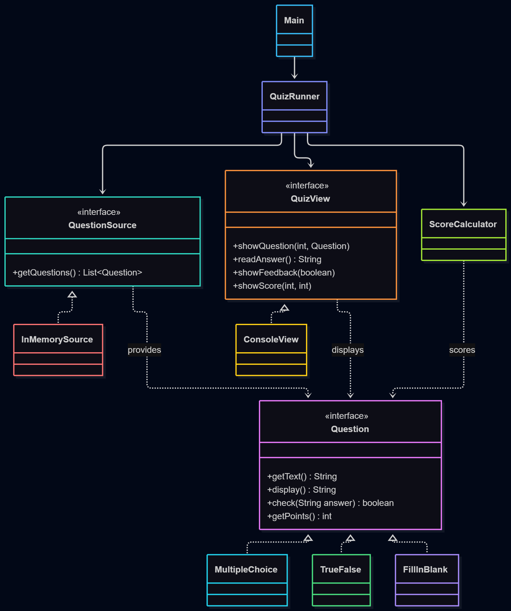

# Laboratory Work 0: SOLID Principles

**Course:** Software Design Techniques and Mechanisms (TMPS)
**Author:** Ina Pancenco

## 1. Introduction

**Design Patterns Quiz** is a small Java console application. It asks the user questions about SOLID and design patterns, checks the answers and shows the final score.

There are three types of questions:
- **Multiple choice**: the user picks an option number.
- **True / False**: the user types `true` or `false`.
- **Fill in the blank**: the user types the missing word.

The project is kept simple on purpose so that it can be extended in the next labs with creational, structural and behavioral design patterns.

## 2. SOLID Principles Used

| Principle | Meaning | Where it is used |
|---|---|---|
| **S** – Single Responsibility | A class should have only one reason to change. | `QuizRunner` (quiz flow), `ScoreCalculator` (scoring), `ConsoleView` (input/output) |
| **O** – Open/Closed | Code should be open for extension, closed for modification. | `Question` interface and its implementations |
| **D** – Dependency Inversion | High-level classes depend on abstractions, not on concrete classes. | `QuizRunner` depends on `QuestionSource` and `QuizView` |

## 3. Implementation

### Single Responsibility (S)

Each class does one job:
- `QuizRunner` only controls the order of the quiz: show question → read answer → check → score.
- `ScoreCalculator` only adds up points.
- `ConsoleView` is the only class that uses `System.out` and `Scanner`.

```java
public class ScoreCalculator {
    private int score = 0;

    public void addAnswer(Question question, boolean correct) {
        if (correct) {
            score += question.getPoints();
        }
    }
    ...
}
```

If the way scores are calculated changes, only `ScoreCalculator` is edited. If the console output changes, only `ConsoleView` is edited.

### Open/Closed (O)

All question types implement the same interface:

```java
public interface Question {
    String getText();
    String display();
    boolean check(String answer);
    int getPoints();
}
```

Each type decides for itself how it is displayed and how the answer is checked. To add a new question type (for example, `OrderingQuestion`), we only create a new class that implements `Question`. `QuizRunner` and `ScoreCalculator` do not change.

### Dependency Inversion (D)

`QuizRunner` receives its dependencies through the constructor as interfaces:

```java
public QuizRunner(QuestionSource source, QuizView view, ScoreCalculator calculator) {
    this.source = source;
    this.view = view;
    this.calculator = calculator;
}
```

It does not know whether the questions come from memory, a file or a database, or whether the user interface is a console or a GUI. The concrete classes are chosen only in `Main`:

```java
QuizRunner runner = new QuizRunner(
        new InMemorySource(),
        new ConsoleView(),
        new ScoreCalculator()
);
runner.run();
```

## 4. Class Diagram



### Program Output

<!-- Add a screenshot of the program running here, e.g.  -->

```
Question 1: Which SOLID letter says a class should have one reason to change?
  1) Open/Closed
  2) Single Responsibility
  3) Liskov Substitution
> 2
Correct!

Question 2: Singleton is a creational design pattern. (true/false)
> true
Correct!

Question 3: The ___ pattern builds a complex object step by step. (type the missing word)
> builder
Correct!
```

## 5. How It Works

1. `Main` creates the objects and passes them to `QuizRunner`.
2. `QuizRunner` gets the list of questions from `QuestionSource`.
3. For each question it:
   - shows it through `QuizView`;
   - reads the user's answer;
   - calls `question.check(answer)`;
   - shows "Correct!" or "Wrong.";
   - sends the result to `ScoreCalculator`.
4. At the end, `QuizView` shows the final score.


## 6. Conclusion

In this lab I built a small quiz application and applied three SOLID principles:
- **Single Responsibility** made each class small and easy to understand.
- **Open/Closed** allows adding new question types without changing existing code.
- **Dependency Inversion** separated the quiz logic from the data source and the user interface, so they can be replaced easily.

This structure will make it easier to add design patterns in the next labs, for example a Factory for creating questions, a Builder for quizzes, and Strategy or Observer for scoring and notifications.
