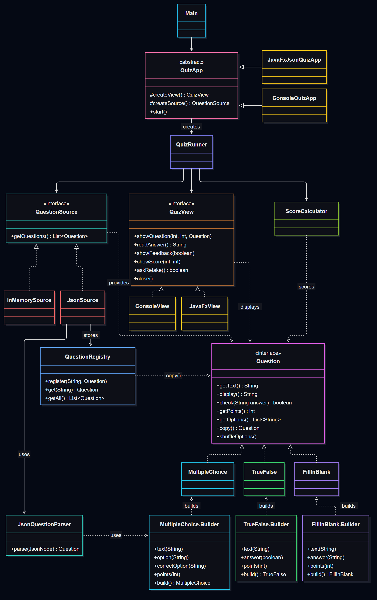
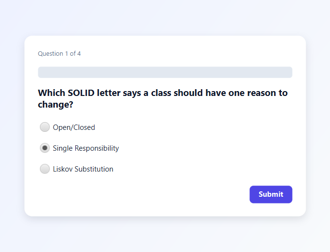
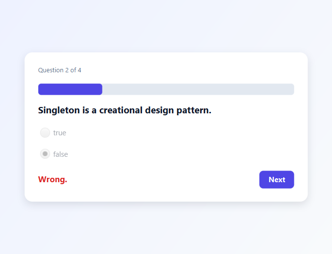
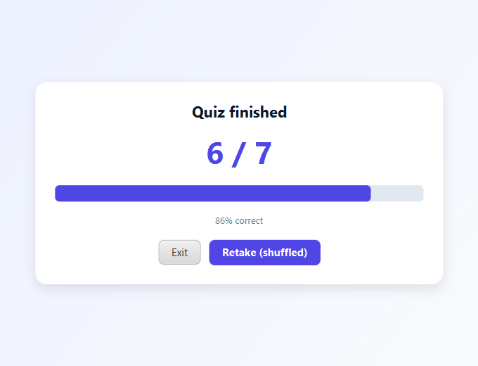

# Laboratory Work 1: Creational Design Patterns

**Course:** Software Design Techniques and Mechanisms (TMPS)
**Author:** Ina Pancenco

## 1. Introduction

This lab continues the **Design Patterns Quiz** from Lab 0. The code was copied into a new package, `org.example.Lab1`, so that Lab 0 stays unchanged.

New in this lab:
- questions can now be loaded from **JSON files** (`src/main/resources/quizzes/`), not only from memory;
- the Swing pop-ups were replaced by a **JavaFX window** with radio buttons and progress bars;
- after finishing, the user can **retake** the quiz, with the questions and the answer options shuffled;
- three creational design patterns are implemented: **Builder**, **Factory Method** and **Prototype**.

The SOLID structure from Lab 0 (`QuizRunner`, `ScoreCalculator`, `QuestionSource`, `QuizView`) is kept, and the patterns are built on top of it.

## 2. Creational Patterns Used

| Pattern | Problem it solves | Where it is used |
|---|---|---|
| **Builder** | Constructors with many parameters are hard to read and easy to call wrong. | `MultipleChoice.Builder`, `TrueFalse.Builder`, `FillInBlank.Builder` |
| **Factory Method** | `Main` created concrete classes with `new`, so changing the view or source meant editing it. | `QuizApp` with `createView()` / `createSource()`, subclasses `JavaFxJsonQuizApp`, `ConsoleQuizApp` |
| **Prototype** | Reading and parsing JSON is slow, and shuffling would change the original questions. | `Question.copy()`, `QuestionRegistry`, used by `JsonSource` |

## 3. Project Structure

```
Lab1/
├── Main.java
├── QuizRunner.java
├── ScoreCalculator.java
├── App/          QuizApp, JavaFxJsonQuizApp, ConsoleQuizApp     (Factory Method)
├── Questions/    Question, MultipleChoice, TrueFalse, FillInBlank (Builder + Prototype)
│                 QuestionRegistry                               (Prototype registry)
├── Sources/      QuestionSource, InMemorySource, JsonSource, JsonQuestionParser
└── View/         QuizView, ConsoleView, JavaFxView

resources/          quiz.css (JavaFX styles)
resources/quizzes/  solid.json, creational-patterns.json, oop-basics.json
```

## 4. Implementation

### Builder

In Lab 0 a question was created like this:

```java
new MultipleChoice("What is S in SOLID?", List.of("Sorry","Select","Straight","Single Responsibility"), 3, 2)
```

It is not clear what `3` and `2` mean, and it is easy to swap them. Now every question type has a static nested `Builder`, and the constructor is `private`, so the builder is the only way to create a question:

```java
new MultipleChoice.Builder()
        .text("What is S in SOLID?")
        .option("Sorry")
        .option("Select")
        .option("Straight")
        .correctOption("Single Responsibility")
        .points(2)
        .build();
```

`correctOption(...)` adds the option and marks it as correct, so the index never has to be counted by hand. `build()` checks that the object is valid before creating it (text is not empty, at least 2 options, a correct option exists, options are different, points are positive):

```java
public MultipleChoice build() {
    if (options.size() < 2) {
        throw new IllegalStateException("Multiple choice question needs at least 2 options: " + text);
    }
    if (correctIndex < 0) {
        throw new IllegalStateException("Multiple choice question needs a correct option: " + text);
    }
    ...
    return new MultipleChoice(this);
}
```

The builders are used in two places: `InMemorySource` and `JsonQuestionParser`. Because of the validation in `build()`, a mistake in a JSON file is reported with a clear message.

### Factory Method

`QuizApp` defines the algorithm for starting the quiz, but leaves the creation of the view and the source to its subclasses:

```java
public abstract class QuizApp {

    protected abstract QuizView createView();

    protected abstract QuestionSource createSource();

    public final void start() {
        QuizRunner runner = new QuizRunner(createSource(), createView(), new ScoreCalculator());
        runner.run();
    }
}
```

Each subclass decides which concrete objects are created:

```java
public class JavaFxJsonQuizApp extends QuizApp {
    protected QuizView createView() { return new JavaFxView(); }
    protected QuestionSource createSource() {
        return new JsonSource("solid.json", "creational-patterns.json", "oop-basics.json");
    }
}

public class ConsoleQuizApp extends QuizApp {
    protected QuizView createView() { return new ConsoleView(); }
    protected QuestionSource createSource() { return new InMemorySource(); }
}
```

`Main` only chooses which app to start:

```java
QuizApp app = new JavaFxJsonQuizApp();
app.start();
```

To add a new combination (for example a console quiz from JSON files) only a new subclass is written; `QuizApp`, `QuizRunner` and the views stay the same.

### Prototype

Every question can copy itself:

```java
public interface Question {
    ...
    Question copy();
    default void shuffleOptions() { }
}
```

`MultipleChoice` makes a **deep copy**: the copy gets its own list of options. This matters because `shuffleOptions()` changes that list:

```java
private MultipleChoice(MultipleChoice other) {
    this.text = other.text;
    this.options = new ArrayList<>(other.options);
    this.correctIndex = other.correctIndex;
    this.points = other.points;
}

@Override
public void shuffleOptions() {
    String correctOption = options.get(correctIndex);
    Collections.shuffle(options);
    correctIndex = options.indexOf(correctOption);
}
```

`QuestionRegistry` keeps the original questions (the prototypes) and only gives out copies:

```java
public List<Question> getAll() {
    List<Question> copies = new ArrayList<>();
    for (Question prototype : prototypes.values()) {
        copies.add(prototype.copy());
    }
    return copies;
}
```

`JsonSource` reads and parses the files **once**, in the constructor, and stores each question in the registry. Every call to `getQuestions()` returns fresh copies instead of reading the files again. When the user retakes the quiz, `QuizRunner` shuffles the copies, and the original questions are not affected:

```java
questions = new ArrayList<>(source.getQuestions());
Collections.shuffle(questions);
questions.forEach(Question::shuffleOptions);
```

## 5. JSON Question Source

`JsonSource` is a new `QuestionSource`, so `QuizRunner` did not need any change to support it (Open/Closed and Dependency Inversion from Lab 0). The files are in `src/main/resources/quizzes/` and are read with the Jackson library. Example:

```json
{
  "title": "Creational Design Patterns",
  "questions": [
    {
      "type": "multiple_choice",
      "text": "Which pattern creates new objects by copying an existing object?",
      "options": ["Singleton", "Prototype", "Builder", "Object Pool"],
      "answer": "Prototype",
      "points": 2
    },
    { "type": "true_false", "text": "Object Pool creates a new object every time one is requested.", "answer": false, "points": 1 },
    { "type": "fill_in_blank", "text": "The ___ pattern builds a complex object step by step.", "answer": "Builder", "points": 2 }
  ]
}
```

For multiple choice the answer is the text of the correct option, not its index, so the file is easier to write and stays correct even if the options are reordered. `JsonQuestionParser` reads the `type` field and uses the matching builder.

There are three files: `solid.json` (3 questions), `creational-patterns.json` (4 questions) and `oop-basics.json` (3 questions).

### JavaFX Interface

`JavaFxView` is a new `QuizView` that shows the quiz in a modern window made with JavaFX (styled with `src/main/resources/quiz.css`):
- a progress bar and "Question n of N" at the top;
- **radio buttons** for multiple choice and true/false questions, and a text field for fill in the blank;
- a **Submit** button that is enabled only after an answer is chosen, then green or red feedback and a **Next** button;
- a final screen with the score, a progress bar and the **Retake** / **Exit** buttons.

To draw radio buttons, the view must know the options, so `Question` got a new method with a default body. `MultipleChoice` returns its options and `TrueFalse` returns `true` and `false`. The chosen radio button returns its number ("1", "2", ...), which is exactly what `check()` already expects, so the checking code did not change:

```java
default List<String> getOptions() {
    return List.of();
}
```

**Threading.** JavaFX is event-driven: it runs on its own thread and calls the code when a button is clicked, while `QuizRunner` expects methods like `readAnswer()` that wait for the answer. `JavaFxView` connects the two: each method builds its screen on the JavaFX thread with `Platform.runLater` and then waits on a `CompletableFuture` that the button completes:

```java
private <T> T waitFor(Consumer<CompletableFuture<T>> screen) {
    CompletableFuture<T> result = new CompletableFuture<>();
    Platform.runLater(() -> screen.accept(result));
    return result.join();
}

public String readAnswer() {
    return waitFor(this::showQuestionScreen);   // Submit calls result.complete(answer)
}
```

`QuizView` also got two small changes: `showQuestion()` now receives the total number of questions (for the progress bar), and a `close()` method with an empty default body, which `QuizRunner` calls at the end so the window closes. Thanks to Factory Method, switching from Swing to JavaFX only meant writing `JavaFxView` and a new `QuizApp` subclass; the questions, sources and scoring did not change.

## 6. Class Diagram



### Program Output

JavaFX version (`JavaFxJsonQuizApp`):

 



Console version (`ConsoleQuizApp`), with a retake:

```
Question 1/4: Which SOLID letter says a class should have one reason to change?
  1) Open/Closed
  2) Single Responsibility
  3) Liskov Substitution
> 2
Correct!
...
Your score: 7 / 7
Retake the quiz? (y/n) > y

Question 1/4: Which SOLID letter says a class should have one reason to change?
  1) Liskov Substitution
  2) Open/Closed
  3) Single Responsibility
> 1
Wrong.
...
```

On the retake the order of the questions and of the options is different, and the answers are still checked correctly.

## 7. How It Works

1. `Main` creates a `JavaFxJsonQuizApp` and calls `start()`; the window opens.
2. `start()` calls the factory methods `createSource()` and `createView()`, then gives the objects to `QuizRunner`.
3. `JsonSource` reads the JSON files once; `JsonQuestionParser` builds each question with its `Builder`, and the question is stored in `QuestionRegistry`.
4. `QuizRunner` gets copies of the questions, asks them one by one and sends the results to `ScoreCalculator`.
5. At the end the score is shown and the user is asked about a retake. On a retake, new copies are taken from the registry and shuffled.
6. When the user does not retake, `QuizRunner` calls `view.close()` and the window closes.

## 8. Conclusion

In this lab I added three creational design patterns to the quiz application:
- **Builder** made question creation readable and checks that every question is valid, both for questions written in code and those read from JSON.
- **Factory Method** moved the choice of concrete view and source out of `Main` into `QuizApp` subclasses, so new combinations can be added without changing existing code.
- **Prototype** lets the JSON files be parsed only once and makes it safe to shuffle questions for a retake, because only copies are changed.

Thanks to the SOLID structure from Lab 0, the new JSON source and the JavaFX interface were added without changing how `QuizRunner` asks the questions.
