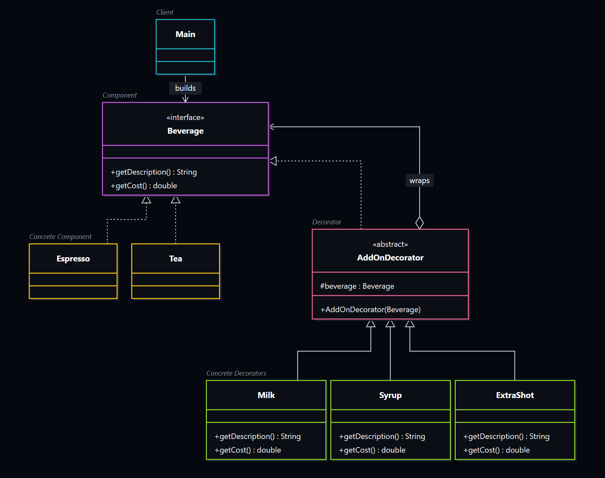
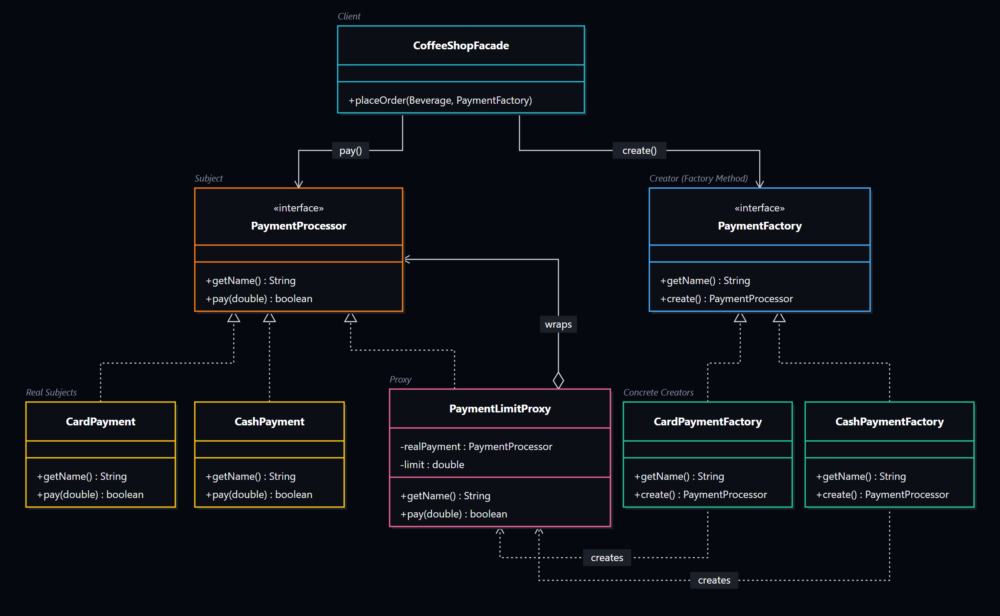
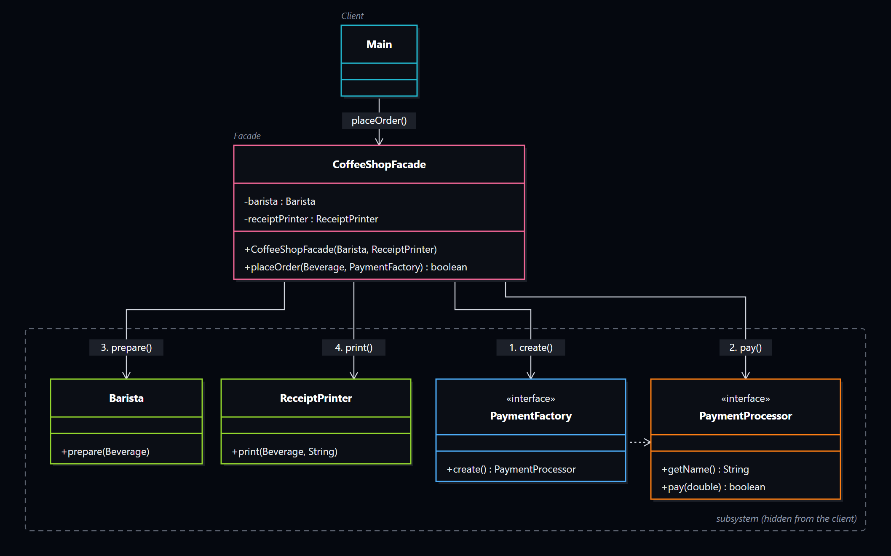

# Laboratory Work 2: Structural Design Patterns

**Course:** Software Design Techniques and Mechanisms (TMPS)
**Author:** Ina Pancenco

## 1. Domain Description

**Coffee Shop Ordering** is a small Java console application (package `org.example.Lab3`). The user chooses a base drink (**Espresso** or **Tea**), adds any number of add-ons (**Milk**, **Syrup**, **Extra Shot**) in any order, and pays by **Card** or **Cash**. Each payment type has a limit: card payments up to $50.00, cash payments up to $3.00 (the register keeps little change). If the payment is accepted, the barista prepares the drink and a receipt is printed; if not, the order is cancelled.

The project is new; it does not extend the quiz from Lab 1. To meet the requirement of reusing a creational pattern, the payment objects are created with **Factory Method**.

## 2. Patterns Used

| Pattern | Type | Problem it solves in this project | Classes |
|---|---|---|---|
| **Decorator** | structural | Add-ons can be combined in any way; a class for every combination (`EspressoWithMilkAndSyrup`, ...) is impossible to maintain. | `AddOnDecorator`, `Milk`, `Syrup`, `ExtraShot` |
| **Proxy** | structural | Payments must be checked against a limit before they happen, without changing the payment classes and without the facade knowing about the check. | `PaymentLimitProxy` |
| **Facade** | structural | Placing an order needs several steps and classes; the client should only make one call. | `CoffeeShopFacade` |
| **Factory Method** | creational | Each payment must be created together with its proxy and its own limit; the facade should not know the concrete classes. | `PaymentFactory`, `CardPaymentFactory`, `CashPaymentFactory` |

### Project Structure

```
src/main/java/org/example/Lab3/
├── Main.java                                              (client)
├── Beverage/    Beverage, Espresso, Tea                   (domain: drinks)
├── Decorator/   AddOnDecorator, Milk, Syrup, ExtraShot    (Decorator)
├── Payment/     PaymentProcessor, CardPayment, CashPayment (domain: payments)
├── Proxy/       PaymentLimitProxy                         (Proxy)
├── Factory/     PaymentFactory, CardPaymentFactory, CashPaymentFactory  (Factory Method)
└── Facade/      CoffeeShopFacade, Barista, ReceiptPrinter (Facade + subsystem)

src/test/java/org/example/Lab3/
    DecoratorTest, ProxyTest, FacadeTest, PatternInteractionTest
```

### How the Patterns Interact

One order passes through all the patterns:

```
Main ──placeOrder(drink, factory)──► CoffeeShopFacade                 (Facade)
                                        │ 1. factory.create()         (Factory Method)
                                        │       └► PaymentLimitProxy(CardPayment / CashPayment)
                                        │ 2. payment.pay(drink.getCost())
                                        │       └► limit check ──► real payment   (Proxy)
                                        │ 3. barista.prepare(drink)
                                        │ 4. receiptPrinter.print(drink, ...)
drink = new Syrup(new Milk(new Espresso()))                           (Decorator)
```

The client code depends only on abstractions: the facade receives a `Beverage` and a `PaymentFactory`, and works with a `PaymentProcessor`. It does not know if the drink is decorated, which payment class is used, or that a proxy is in front of it.

## 3. Decorator

**Intent:** add responsibilities to an object at runtime by wrapping it, in any combination.

**Roles:** `Beverage` – Component; `Espresso`, `Tea` – Concrete Components; `AddOnDecorator` – Base Decorator; `Milk`, `Syrup`, `ExtraShot` – Concrete Decorators.

### Class Diagram



### Code

[AddOnDecorator.java](../src/main/java/org/example/Lab3/Decorator/AddOnDecorator.java), [Milk.java](../src/main/java/org/example/Lab3/Decorator/Milk.java)

```java
public abstract class AddOnDecorator implements Beverage {
    protected final Beverage beverage;

    protected AddOnDecorator(Beverage beverage) {
        this.beverage = beverage;
    }
}

public class Milk extends AddOnDecorator {
    public Milk(Beverage beverage) {
        super(beverage);
    }

    @Override
    public String getDescription() {
        return beverage.getDescription() + ", Milk";
    }

    @Override
    public double getCost() {
        return beverage.getCost() + 0.50;
    }
}
```

`AddOnDecorator` **is** a `Beverage` and **has** a `Beverage`, so a decorator can wrap a plain drink or another decorator. Each add-on calls the wrapped drink first and then adds its own part, so `new Syrup(new Milk(new Espresso()))` costs 2.00 + 0.50 + 0.60 = **3.10**. In `Main` the wrapping happens at runtime, from the user's choices (`drink = new Milk(drink);`).

**Open for extension:** a new add-on (for example `Cinnamon`) is one new class that extends `AddOnDecorator`; no existing class changes.

### Unit Tests ([DecoratorTest.java](../src/test/java/org/example/Lab3/DecoratorTest.java))

| Test | What it checks |
|---|---|
| `decoratorsStackedInAnyOrderGiveTheSameCost` | `Syrup(Milk(Espresso))` and `Milk(Syrup(Espresso))` both cost 3.10. |
| `eachDecoratorAddsItsNameInTheOrderItWasAdded` | `ExtraShot(Milk(Espresso))` is described as `"Espresso, Milk, Extra Shot"`. |
| `sameDecoratorCanBeAddedTwice` | `Milk(Milk(Tea))` is `"Tea, Milk, Milk"` and costs 2.50. |

## 4. Proxy

**Intent:** control access to an object through a stand-in with the same interface.

**Roles:** `PaymentProcessor` – Subject; `CardPayment`, `CashPayment` – Real Subjects; `PaymentLimitProxy` – Proxy. The diagram also shows the factories (Factory Method) that create the proxy.

### Class Diagram



### Code

[PaymentLimitProxy.java](../src/main/java/org/example/Lab3/Proxy/PaymentLimitProxy.java)

```java
public class PaymentLimitProxy implements PaymentProcessor {
    private final PaymentProcessor realPayment;
    private final double limit;

    public PaymentLimitProxy(PaymentProcessor realPayment, double limit) {
        this.realPayment = realPayment;
        this.limit = limit;
    }

    @Override
    public String getName() {
        return realPayment.getName();
    }

    @Override
    public boolean pay(double amount) {
        if (amount > limit) {
            System.out.printf("[Proxy] Blocked: $%.2f is over the %s limit of $%.2f.%n",
                    amount, realPayment.getName(), limit);
            return false;
        }
        return realPayment.pay(amount);
    }
}
```

The proxy implements the same `PaymentProcessor` interface as the real payment, so the facade cannot tell them apart. Before delegating, it checks the amount: payments over the limit are blocked and the real payment is **never called**; allowed payments are passed through **unchanged**. The payment classes stay simple and do not need to know about limits.

The difference from Decorator: the proxy does not add new behaviour to the result, it decides **whether** the real object is called at all.

### Unit Tests ([ProxyTest.java](../src/test/java/org/example/Lab3/ProxyTest.java))

The tests use a stub `RecordingPayment` that remembers how many times it was called and with which amount.

| Test | What it checks |
|---|---|
| `proxyBlocksPaymentOverTheLimit` | `pay(3.10)` with limit 3.00 returns `false` and the real payment is called 0 times. |
| `proxyPassesAllowedPaymentThroughUnchanged` | `pay(2.50)` returns the real result and the real payment receives exactly 2.50. |
| `proxyHasTheSameInterfaceAsTheRealPayment` | The proxy is used as a `PaymentProcessor` and `getName()` returns the real payment's name. |

## 5. Facade

**Intent:** provide one simple interface to a complex subsystem.

**Roles:** `CoffeeShopFacade` – Facade; `Barista`, `ReceiptPrinter`, `PaymentFactory`, `PaymentProcessor` – subsystem; `Main` – Client.

### Class Diagram



### Code

[CoffeeShopFacade.java](../src/main/java/org/example/Lab3/Facade/CoffeeShopFacade.java)

```java
public class CoffeeShopFacade {
    private final Barista barista;
    private final ReceiptPrinter receiptPrinter;

    public CoffeeShopFacade(Barista barista, ReceiptPrinter receiptPrinter) {
        this.barista = barista;
        this.receiptPrinter = receiptPrinter;
    }

    public boolean placeOrder(Beverage beverage, PaymentFactory paymentFactory) {
        System.out.printf("%nNew order: %s ($%.2f)%n", beverage.getDescription(), beverage.getCost());

        PaymentProcessor payment = paymentFactory.create();
        if (!payment.pay(beverage.getCost())) {
            System.out.println("Payment failed. Order cancelled.");
            return false;
        }

        barista.prepare(beverage);
        receiptPrinter.print(beverage, payment.getName());
        return true;
    }
}
```

The client calls only `placeOrder(...)`. The facade has no business logic of its own: it only **delegates** to the subsystem in the right order (create payment → pay → prepare → print) and stops if the payment fails. The subsystem objects are passed through the constructor, so they can be replaced with stubs in the tests.

### Unit Tests ([FacadeTest.java](../src/test/java/org/example/Lab3/FacadeTest.java))

The tests use stub `Barista`, `ReceiptPrinter` and `PaymentFactory` objects that only write their name into a shared list.

| Test | What it checks |
|---|---|
| `facadeCallsSubsystemInTheRightOrder` | After a successful order the calls are exactly `[pay, prepare, print]`. |
| `facadeStopsWhenPaymentFails` | If the payment returns `false`, the calls are only `[pay]`; the barista and the printer are not called. |

## 6. Factory Method (creational pattern reused)

[PaymentFactory.java](../src/main/java/org/example/Lab3/Factory/PaymentFactory.java), [CashPaymentFactory.java](../src/main/java/org/example/Lab3/Factory/CashPaymentFactory.java)

```java
public interface PaymentFactory {
    String getName();

    PaymentProcessor create();
}

public class CashPaymentFactory implements PaymentFactory {
    private static final double CASH_LIMIT = 3.00;

    public String getName() { return "Cash"; }

    public PaymentProcessor create() {
        return new PaymentLimitProxy(new CashPayment(), CASH_LIMIT);
    }
}
```

Each factory knows how to build its payment **already wrapped in the proxy** with the right limit. The facade only calls `create()` and gets a `PaymentProcessor`. `Main` builds the payment menu from a list of factories:

```java
List<PaymentFactory> payments = List.of(new CardPaymentFactory(), new CashPaymentFactory());
```

**Open for extension:** a new payment type (for example `MobilePayment`) needs only two new classes, `MobilePayment` and `MobilePaymentFactory`, plus one entry in this list. The facade, the proxy and the existing payments do not change.

### Pattern Interaction Tests ([PatternInteractionTest.java](../src/test/java/org/example/Lab3/PatternInteractionTest.java))

These tests use the real classes and go through Facade → Factory → Proxy → real payment with a decorated drink:

| Test | What it checks |
|---|---|
| `decoratedDrinkOverCashLimitIsBlockedByProxy` | `Syrup(Milk(Espresso))` ($3.10) paid in cash is refused (cash limit $3.00). |
| `sameDrinkCanBePaidByCard` | The same drink paid by card ($50.00 limit) is accepted. |

### Test Results

All tests run with one command, `mvn test`:

```
[INFO] Running org.example.Lab3.DecoratorTest
[INFO] Tests run: 3, Failures: 0, Errors: 0, Skipped: 0 -- in org.example.Lab3.DecoratorTest
[INFO] Running org.example.Lab3.FacadeTest
[INFO] Tests run: 2, Failures: 0, Errors: 0, Skipped: 0 -- in org.example.Lab3.FacadeTest
[INFO] Running org.example.Lab3.PatternInteractionTest
[INFO] Tests run: 2, Failures: 0, Errors: 0, Skipped: 0 -- in org.example.Lab3.PatternInteractionTest
[INFO] Running org.example.Lab3.ProxyTest
[INFO] Tests run: 3, Failures: 0, Errors: 0, Skipped: 0 -- in org.example.Lab3.ProxyTest
[INFO] Tests run: 10, Failures: 0, Errors: 0, Skipped: 0
[INFO] BUILD SUCCESS
```

## 7. Program Output

Espresso with Milk and Syrup, paid by card:

```
=== Welcome to the Coffee Shop ===
Choose a drink: 1) Espresso ($2.00)  2) Tea ($1.50)
> 1
Current: Espresso = $2.00
Add: 1) Milk (+0.50)  2) Syrup (+0.60)  3) Extra Shot (+0.80)  0) Done
> 1
Current: Espresso, Milk = $2.50
> 2
Current: Espresso, Milk, Syrup = $3.10
> 0
Pay with:  1) Card  2) Cash
> 1

New order: Espresso, Milk, Syrup ($3.10)
[Card] Charged $3.10.
[Barista] Preparing: Espresso, Milk, Syrup
---------- RECEIPT ----------
Item:    Espresso, Milk, Syrup
Total:   $3.10
Paid by: Card
-----------------------------
```

The same drink paid in cash is blocked by the proxy:

```
New order: Espresso, Milk, Syrup ($3.10)
[Proxy] Blocked: $3.10 is over the Cash limit of $3.00.
Payment failed. Order cancelled.
```

Tea with Milk paid in cash (under the limit) passes through the proxy to the real payment:

```
New order: Tea, Milk ($2.00)
[Cash] Received $2.00, change $0.00.
[Barista] Preparing: Tea, Milk
---------- RECEIPT ----------
Item:    Tea, Milk
Total:   $2.00
Paid by: Cash
-----------------------------
```

## 8. Conclusions

In this lab I implemented three structural patterns, **Decorator**, **Proxy** and **Facade**, and reused the creational **Factory Method**. They work together in one order: the drink is built with decorators, the facade runs the order, the factory creates the payment, and the proxy decides if the payment is allowed.

**What was harder than expected:**
- Keeping Proxy and Decorator apart. Both wrap an object with the same interface, so at first they look the same. The difference is the intent: the decorators always call the wrapped drink and add to the result, while the proxy may not call the real payment at all.
- Making the code really open for extension. My first version chose the payment with a `switch` on an enum inside the facade, so a new payment type meant editing the facade. Moving the creation into factory classes fixed this.
- Testing the facade. To check the order of the calls, the barista and the printer had to be passed in through the constructor instead of being created inside the facade.

**What I would design differently:**
- `Barista` and `ReceiptPrinter` could be interfaces, so the tests would not need to extend concrete classes.
- The limits are constants in the factories; in a bigger project they would come from a configuration file.
- Prices are `double`; for real money `BigDecimal` would avoid rounding problems.
