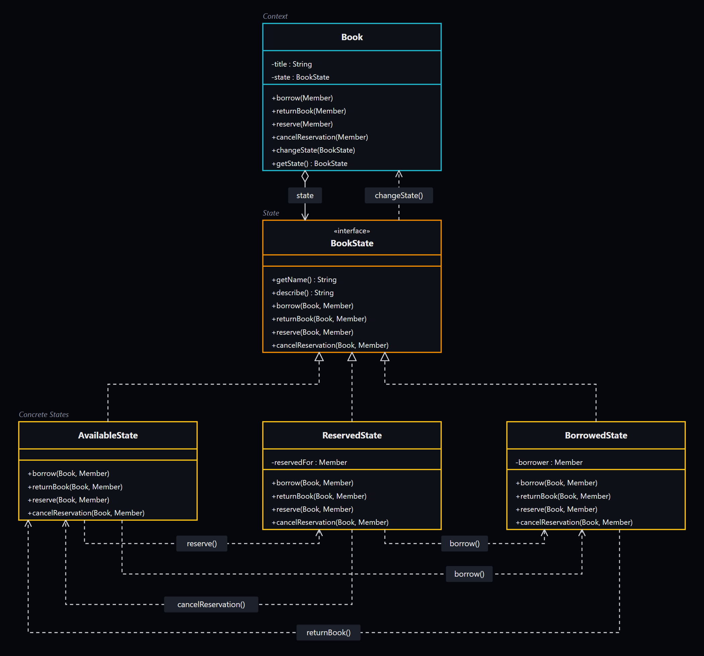
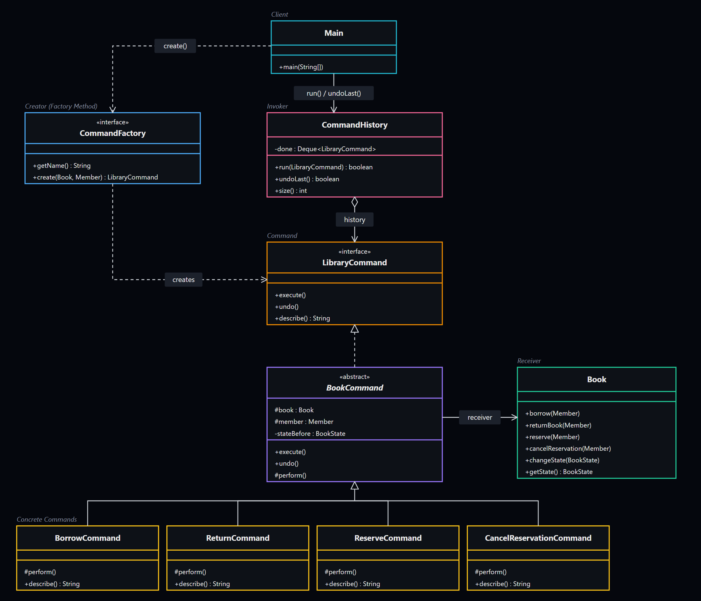
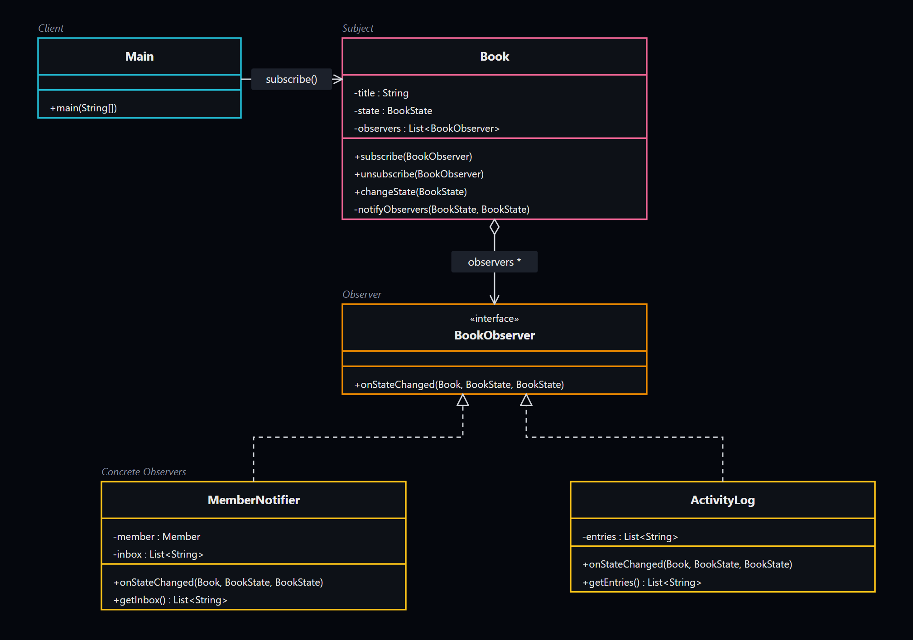

# Laboratory Work 3: Behavioral Design Patterns

**Course:** Software Design Techniques and Mechanisms (TMPS)
**Author:** Ina Pancenco

## 1. Domain Description

**City Library** is a small Java console application (package `org.example.Lab4`). The librarian manages three books and three members (Ana, Ion, Maria). A book can be **borrowed**, **returned**, **reserved** and a reservation can be **cancelled**. What is allowed depends on the book's current situation: a reserved book can only be borrowed by the member it is reserved for, a borrowed book can only be returned by its borrower, and so on. Every action can be **undone**. Members can **follow** or **unfollow** a book at runtime and then receive a message on every change; the activity log records all changes.

To meet the "build on Lab 2" requirement, the commands are created with **Factory Method** (the same idea as the payment factories in the coffee shop).

## 2. Patterns Used

| Pattern | Type | Problem it solves in this project | Classes |
|---|---|---|---|
| **State** | behavioral | The rules for each action depend on the book's situation. Without State, `Book` would have a `switch` on a status enum in every method. | `BookState`, `AvailableState`, `ReservedState`, `BorrowedState`, `Book` (context) |
| **Command** | behavioral | Librarian actions must be undoable and kept in a history; the menu should not know which actions exist. | `LibraryCommand`, `BookCommand`, `BorrowCommand`, `ReturnCommand`, `ReserveCommand`, `CancelReservationCommand`, `CommandHistory` (invoker) |
| **Observer** | behavioral | Members and the log must learn about changes without `Book` knowing who they are; members follow and unfollow books at runtime. | `BookObserver`, `MemberNotifier`, `ActivityLog`, `Book` (subject) |
| **Factory Method** | creational (reused) | The menu creates commands without naming concrete command classes. | `CommandFactory`, `BorrowCommandFactory`, `ReturnCommandFactory`, `ReserveCommandFactory`, `CancelReservationCommandFactory` |

### Project Structure

```
src/main/java/org/example/Lab4/
├── Main.java                                       (client, console menu)
├── Domain/    Book, Member                         (domain; Book = State context + Observer subject)
├── State/     BookState, AvailableState, ReservedState, BorrowedState      (State)
├── Command/   LibraryCommand, BookCommand, BorrowCommand, ReturnCommand,
│              ReserveCommand, CancelReservationCommand, CommandHistory     (Command)
├── Observer/  BookObserver, MemberNotifier, ActivityLog                    (Observer)
└── Factory/   CommandFactory + one factory per command                     (Factory Method)

src/test/java/org/example/Lab4/
    StateTest, CommandTest, ObserverTest, PatternInteractionTest
```

### How the Patterns Interact

One user action passes through all the patterns:

```
Main ──factory.create(book, member)──► BorrowCommand                    (Factory Method)
Main ──history.run(command)──► CommandHistory                           (Command: invoker)
                                  │ command.execute()
                                  │    └► saves book.getState(), calls book.borrow(member)
                                  ▼
                               Book ──state.borrow(this, member)──► AvailableState   (State)
                                  │ ◄── book.changeState(new BorrowedState(member))
                                  │ notify loop
                                  ▼
                       ActivityLog, MemberNotifier (only the subscribed ones)        (Observer)
```

Undo goes the same way back: `history.undoLast()` → `command.undo()` → `book.changeState(stateBefore)` → observers are notified again.

`Main` works only with `CommandFactory`, `LibraryCommand`, `CommandHistory` and `BookObserver`; `Book` works only with `BookState` and `BookObserver`.

## 3. State

**Intent:** change an object's behaviour when its internal state changes.

**Roles:** `Book` – Context; `BookState` – State; `AvailableState`, `ReservedState`, `BorrowedState` – Concrete States.

### Class Diagram



### Code

[Book.java](../src/main/java/org/example/Lab4/Domain/Book.java), [ReservedState.java](../src/main/java/org/example/Lab4/State/ReservedState.java)

```java
// Book (context): every action is delegated to the current state
public void borrow(Member member) {
    state.borrow(this, member);
}

// ReservedState: decides if the action is allowed and what the next state is
@Override
public void borrow(Book book, Member member) {
    if (!member.equals(reservedFor)) {
        throw new IllegalStateException("'" + book.getTitle() + "' is reserved for " + reservedFor.name() + ".");
    }
    book.changeState(new BorrowedState(member));
}

@Override
public void reserve(Book book, Member member) {
    throw new IllegalStateException("'" + book.getTitle() + "' is already reserved for " + reservedFor.name() + ".");
}
```

`Book` has no `if` or `switch` on its status: it only forwards the call to the current `BookState`. Each state class holds the rules for its situation and chooses the next state, so the transitions live in the state classes, not in the client. A forbidden action throws and the book keeps its state.

**Open for extension:** a new state (for example `InRepairState`) is a new class implementing `BookState`; only the states that lead to it need a new transition.

### Unit Tests ([StateTest.java](../src/test/java/org/example/Lab4/StateTest.java))

| Test | What it checks |
|---|---|
| `validTransitions` | Available → reserve → Reserved → borrow → Borrowed → return → Available. |
| `rejectsForbidden` | Returning an available book, borrowing a borrowed book and returning someone else's book throw `IllegalStateException`, and the state does not change. |
| `reservedOnlyForReserver` | A book reserved for Ana cannot be borrowed or cancelled by Ion. |

## 4. Command

**Intent:** turn a request into an object, so it can be stored, undone or queued.

**Roles:** `LibraryCommand` – Command; `BorrowCommand`, `ReturnCommand`, `ReserveCommand`, `CancelReservationCommand` – Concrete Commands; `BookCommand` – shared base (saves the state for undo); `Book` – Receiver; `CommandHistory` – Invoker; `Main` – Client.

### Class Diagram



### Code

[BookCommand.java](../src/main/java/org/example/Lab4/Command/BookCommand.java), [CommandHistory.java](../src/main/java/org/example/Lab4/Command/CommandHistory.java)

```java
// BookCommand: the execute/undo pair
@Override
public final void execute() {
    stateBefore = book.getState();
    perform();                      // e.g. BorrowCommand: book.borrow(member)
}

@Override
public final void undo() {
    if (stateBefore == null) {
        throw new IllegalStateException("The command was not executed.");
    }
    book.changeState(stateBefore);
}

// CommandHistory (invoker)
public boolean run(LibraryCommand command) {
    System.out.println("> " + command.describe());
    try {
        command.execute();
    } catch (IllegalStateException e) {
        System.out.println("  Rejected: " + e.getMessage());
        return false;           // a rejected command is not saved
    }
    done.push(command);
    return true;
}
```

Each command saves the book's state before it runs, so `undo()` restores the **exact** previous state (for example back to "Reserved for Ana", not just "Available"). The commands contain no business rules: they only call the receiver (`Book`), which asks its state. The invoker keeps only successful commands in a stack, so undo always reverts the last real change.

**Open for extension:** a new action is one command class plus one factory; `CommandHistory` does not change.

### Unit Tests ([CommandTest.java](../src/test/java/org/example/Lab4/CommandTest.java))

| Test | What it checks |
|---|---|
| `undoRestoresState` | Borrow then undo gives back `Available`. |
| `undoGoesBackToReserved` | Reserve + borrow, then undo twice: first back to "Reserved for Ana", then to "Available"; a third undo returns `false`. |
| `rejectedNotInHistory` | A rejected return (wrong member) is not saved and does not change the book. |

## 5. Observer

**Intent:** notify dependent objects automatically when an object changes.

**Roles:** `Book` – Subject; `BookObserver` – Observer; `MemberNotifier`, `ActivityLog` – Concrete Observers.

### Class Diagram



### Code

[Book.java](../src/main/java/org/example/Lab4/Domain/Book.java)

```java
public void changeState(BookState newState) {
    BookState oldState = state;
    state = newState;
    notifyObservers(oldState, newState);
}

public void subscribe(BookObserver observer) {
    if (!observers.contains(observer)) {
        observers.add(observer);
    }
}

public void unsubscribe(BookObserver observer) {
    observers.remove(observer);
}

private void notifyObservers(BookState oldState, BookState newState) {
    // loop over a copy, so an observer may unsubscribe while being notified
    for (BookObserver observer : List.copyOf(observers)) {
        observer.onStateChanged(this, oldState, newState);
    }
}
```

`Book` keeps a list of the `BookObserver` interface and never names a concrete observer. Every state change, including an undo, goes through `changeState`, so the observers cannot miss one. Observers only read the book, they never change it, so there is no update loop. In the menu, `f` / `x` subscribe and unsubscribe a member at runtime.

**Open for extension:** a new observer (for example `EmailNotifier`) is a new class implementing `BookObserver`.

### Unit Tests ([ObserverTest.java](../src/test/java/org/example/Lab4/ObserverTest.java))

| Test | What it checks |
|---|---|
| `allSubscribersNotified` | After a borrow, both the log and Ion's notifier receive the change. |
| `unsubscribedNotNotified` | After Ion unsubscribes, the return is not sent to him. |
| `rejectedActionNotAnnounced` | A forbidden action does not notify anyone. |

## 6. Factory Method (creational pattern reused)

[CommandFactory.java](../src/main/java/org/example/Lab4/Factory/CommandFactory.java), [BorrowCommandFactory.java](../src/main/java/org/example/Lab4/Factory/BorrowCommandFactory.java)

```java
public interface CommandFactory {
    String getName();

    LibraryCommand create(Book book, Member member);
}

public class BorrowCommandFactory implements CommandFactory {
    public String getName() { return "Borrow"; }

    public LibraryCommand create(Book book, Member member) {
        return new BorrowCommand(book, member);
    }
}
```

`Main` builds the action menu from a list of factories, like the payment menu in Lab 2:

```java
List<CommandFactory> actions = List.of(new BorrowCommandFactory(), new ReturnCommandFactory(),
        new ReserveCommandFactory(), new CancelReservationCommandFactory());
```

The client only calls `create(...)` and gets a `LibraryCommand`, then gives it to `CommandHistory`.

### Pattern Interaction Tests ([PatternInteractionTest.java](../src/test/java/org/example/Lab4/PatternInteractionTest.java))

| Test | What it checks |
|---|---|
| `commandChangesStateAndNotifies` | A command from `BorrowCommandFactory`, run by `CommandHistory`, moves the book to "Borrowed by Maria" and the log records `Available -> Borrowed`. |
| `undoIsAnnouncedToo` | After undo, the log contains both changes: `Available -> Borrowed` and `Borrowed -> Available`. |

### Test Results

All tests run with one command, `mvn test`:

```
[INFO] Running org.example.Lab4.CommandTest
[INFO] Tests run: 3, Failures: 0, Errors: 0, Skipped: 0 -- in org.example.Lab4.CommandTest
[INFO] Running org.example.Lab4.ObserverTest
[INFO] Tests run: 3, Failures: 0, Errors: 0, Skipped: 0 -- in org.example.Lab4.ObserverTest
[INFO] Running org.example.Lab4.PatternInteractionTest
[INFO] Tests run: 2, Failures: 0, Errors: 0, Skipped: 0 -- in org.example.Lab4.PatternInteractionTest
[INFO] Running org.example.Lab4.StateTest
[INFO] Tests run: 3, Failures: 0, Errors: 0, Skipped: 0 -- in org.example.Lab4.StateTest
[INFO] Tests run: 21, Failures: 0, Errors: 0, Skipped: 0
[INFO] BUILD SUCCESS
```

(21 = 11 tests for this lab in `org.example.Lab4` + 10 tests from the structural patterns lab in `org.example.Lab3`.)

## 7. Program Output

Ion follows "Clean Code", Ana borrows it (State changes, both observers are notified), and Ion tries to return it (rejected by `BorrowedState`):

```
Member:  1) Ana  2) Ion  3) Maria
Book:  1) Clean Code  2) Design Patterns  3) Refactoring
  Ion now follows 'Clean Code'.
...
> Ana borrows 'Clean Code'
  [Log] Clean Code: Available -> Borrowed
  [Notify Ion] 'Clean Code' is now Borrowed by Ana
...
> Ion returns 'Clean Code'
  Rejected: 'Clean Code' was borrowed by Ana, not by Ion.
```

Maria reserves "Design Patterns", then the reservation is undone:

```
> Maria reserves 'Design Patterns'
  [Log] Design Patterns: Available -> Reserved
...
< Undo: Maria reserves 'Design Patterns'
  [Log] Design Patterns: Reserved -> Available
```

After Ion unfollows "Clean Code", he is no longer notified; the history shows only successful commands:

```
  Ion no longer follows 'Clean Code'.
...
> Ana returns 'Clean Code'
  [Log] Clean Code: Borrowed -> Available
...
> Ion borrows 'Clean Code'
  [Log] Clean Code: Available -> Borrowed
...
History (newest first): [Ion borrows 'Clean Code', Ana returns 'Clean Code', Ana borrows 'Clean Code']
```

## 8. Conclusions

In this lab I implemented three behavioral patterns, **State**, **Command** and **Observer**, and reused the creational **Factory Method**. They work together on one action: the factory creates the command, the invoker runs it, the book's state decides what happens, and the observers are told about the change.

**What was harder than expected:**
- Undo. My first idea was to undo with the opposite action (undo borrow = return), but after "reserve, then borrow" the opposite action gives "Available" instead of "Reserved for Ana". Saving the previous state in the command fixed it.
- Deciding where the rules live. It was tempting to check "is this the right member?" inside the commands, but then the commands would contain business logic. The rules stay in the states; the commands only call the book.
- Rejected actions. The invoker must not save a command that failed, otherwise undo would "revert" something that never happened.

**What I would design differently:**
- `changeState` is public so the states (in another package) and undo can use it; a client could call it directly and skip the rules. Putting `Book` and the states in one package with a package-private method would prevent this.
- The saved state works as a very simple memento; with more data in a book (due dates, fines) a real Memento would be needed.
- Reservations while a book is borrowed (a waiting queue) would be a natural next state.
